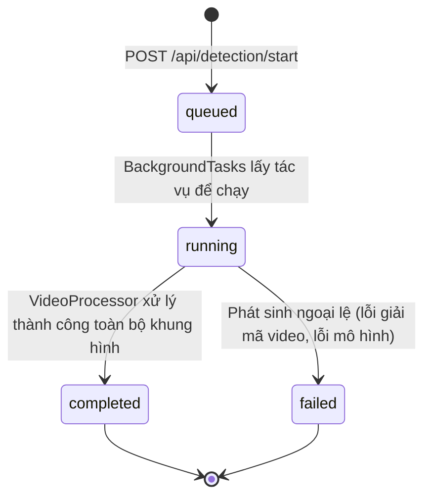

# Tài liệu Đặc tả REST API - ITS Wrong-Lane Detection

Tài liệu này cung cấp đặc tả kỹ thuật chi tiết toàn bộ hệ thống Application Programming Interface (REST API) của hệ thống nhận diện phương tiện đi sai làn đường (**ITS Wrong-Lane Detection**), phục vụ kết nối và tích hợp giữa Client (Giao diện Web Frontend, hệ thống giám sát ITS bên ngoài) và Server (FastAPI Backend).
  
**Phiên bản API:** `0.1.0`  
**Base URL:** `http://localhost:8000/api`  
**Đặc tả chuẩn OpenAPI 3.0:** `http://localhost:8000/openapi.json`  
**Giao diện Swagger UI (Interactive Docs):** `http://localhost:8000/docs`  
**Giao diện ReDoc:** `http://localhost:8000/redoc`

---

## 1. Nguyên tắc thiết kế và Quy chuẩn chung

### 1.1. Kiến trúc RESTful
- Mọi tài nguyên (Resources) được định danh rõ ràng thông qua danh từ số nhiều: `/videos`, `/detection`, `/violations`, `/statistics`.
- Sử dụng đúng ngữ nghĩa các phương thức chuẩn của giao thức HTTP:
  - `GET`: Truy vấn và đọc dữ liệu (an toàn - safe, có tính lũy suy - idempotent).
  - `POST`: Khởi tạo tài nguyên mới (tải lên file video, kích hoạt tác vụ nhận diện).
- Định dạng dữ liệu trao đổi:
  - Yêu cầu và phản hồi thông thường: `application/json; charset=utf-8`.
  - Tải lên tệp video: `multipart/form-data`.
  - Truyền phát video kết quả: `video/mp4`.

### 1.2. Chuẩn mã trạng thái HTTP (HTTP Status Codes)
Hệ thống tuân thủ nghiêm ngặt các mã trạng thái chuẩn RFC 7231:

| Mã HTTP | Tên mã | Ý nghĩa & Ứng dụng trong hệ thống |
|:---:|---|---|
| **`200 OK`** | Thành công | Yêu cầu thực thi thành công, trả về dữ liệu tương ứng. |
| **`201 Created`** | Đã tạo mới | Tài nguyên đã được khởi tạo thành công (dùng cho upload video). |
| **`202 Accepted`** | Đã tiếp nhận | Yêu cầu đã được tiếp nhận và đưa vào hàng đợi xử lý nền (dùng khi bắt đầu tác vụ nhận diện). |
| **`400 Bad Request`** | Yêu cầu không hợp lệ | Định dạng file không được hỗ trợ, file rỗng hoặc kích thước vượt ngưỡng cho phép. |
| **`404 Not Found`** | Không tìm thấy | Không tồn tại tài nguyên tương ứng với ID được chỉ định (`video_id`, `task_id`). |
| **`409 Conflict`** | Xung đột trạng thái | Yêu cầu kết quả khi tác vụ nhận diện vẫn đang chạy (`queued` hoặc `running`). |
| **`422 Unprocessable`** | Lỗi dữ liệu Pydantic | Dữ liệu JSON hoặc tham số gửi lên không đúng định dạng schema. |
| **`500 Server Error`** | Lỗi hệ thống | Ngoại lệ phát sinh ngoài ý muốn từ phía máy chủ backend. |

### 1.3. Định dạng thời gian và Cấu trúc phản hồi lỗi
- Mọi trường thời gian (`uploaded_at`, `created_at`, `updated_at`, `detected_at`) đều tuân theo định dạng chuẩn quốc tế **ISO 8601** (ví dụ: `2026-11-19T08:30:00Z`).
- Cấu trúc phản hồi lỗi chuẩn (Standard Error Response):
```json
{
  "detail": "Mô tả nguyên nhân lỗi chi tiết bằng tiếng Việt hoặc tiếng Anh kỹ thuật"
}
```

---

## 2. Bảng tổng hợp Danh mục Endpoints (API Catalog)

Hệ thống cung cấp 10 endpoints REST được chia thành 5 nhóm chức năng chính:

| STT | Phương thức | Đường dẫn Endpoint | Nhóm chức năng | Tóm tắt mục đích | Trạng thái phản hồi |
|:---:|:---:|---|---|---|:---:|
| 1 | `GET` | `/api/health` | Giám sát | Kiểm tra trạng thái hoạt động máy chủ, CSDL và mô hình AI | `200 OK` |
| 2 | `POST` | `/api/videos/upload` | Quản lý Video | Tải lên file video giao thông (MP4, AVI, MOV, MKV) | `201 Created` |
| 3 | `GET` | `/api/videos` | Quản lý Video | Lấy danh sách video đã tải kèm metadata tổng hợp | `200 OK` |
| 4 | `GET` | `/api/videos/{video_id}` | Quản lý Video | Xem thông tin chi tiết metadata của một video theo ID | `200 OK` |
| 5 | `POST` | `/api/detection/start` | Tác vụ Nhận diện | Kích hoạt tác vụ nhận diện chạy ngầm trong BackgroundTasks | `202 Accepted` |
| 6 | `GET` | `/api/detection/{task_id}/status` | Tác vụ Nhận diện | Polling tiến trình xử lý (trạng thái, phần trăm, khung hình) | `200 OK` |
| 7 | `GET` | `/api/detection/{task_id}/result` | Tác vụ Nhận diện | Lấy kết quả tổng hợp sau khi tác vụ nhận diện hoàn tất | `200 OK` / `409 Conflict` |
| 8 | `GET` | `/api/detection/{task_id}/video` | Tác vụ Nhận diện | Tải hoặc truyền phát (stream) video đầu ra đã vẽ bounding box | `200 OK` |
| 9 | `GET` | `/api/violations` | Tra cứu Vi phạm | Lấy danh sách phương tiện đi sai làn kèm snapshot bằng chứng | `200 OK` |
| 10 | `GET` | `/api/statistics` | Thống kê | Thống kê số liệu hệ thống lưu vết từ SQLite | `200 OK` |

---

## 3. Đặc tả chi tiết từng Endpoint

### 3.1. Nhóm Giám sát hệ thống (Health Check)

#### `GET /api/health`
- **Mục đích:** Kiểm tra trạng thái hoạt động của Backend, tình trạng kết nối CSDL SQLite, sự sẵn sàng của file trọng số mô hình YOLO và cấu hình làn đường. Thường được gọi bởi Frontend lúc khởi động hoặc hệ thống điều phối container/load balancer.
- **Headers:** Không yêu cầu.
- **Parameters:** Không có.
- **Response `200 OK` (`HealthResponse`):**
```json
{
  "status": "ok",
  "service": "its-wrong-lane-detection",
  "version": "0.1.0",
  "database": "connected",
  "model_ready": true,
  "lane_config_ready": true,
  "warnings": []
}
```
- **Ví dụ gọi cURL:**
```bash
curl -X GET "http://localhost:8000/api/health" -H "Accept: application/json"
```

---

### 3.2. Nhóm Quản lý Video (Video Management)

#### `POST /api/videos/upload`
- **Mục đích:** Tiếp nhận file video giao thông từ người dùng, kiểm tra định dạng và kích thước, lưu trữ phân mảnh an toàn (chunk 1MB) vào thư mục `storage/uploads/`, đồng thời ghi nhận metadata vào cơ sở dữ liệu.
- **Content-Type:** `multipart/form-data`
- **Request Body:**
  - `file` (UploadFile, bắt buộc): Tệp video hợp lệ (`.mp4`, `.avi`, `.mov`, `.mkv`), dung lượng tối đa cấu hình qua `MAX_UPLOAD_SIZE_MB` (mặc định 500MB).
- **Phản hồi thành công `201 Created` (`VideoRead`):**
```json
{
  "id": "a1b2c3d4-e5f6-7890-abcd-ef1234567890",
  "original_filename": "traffic_crossroad_01.mp4",
  "size_bytes": 15485760,
  "uploaded_at": "2026-11-19T08:30:00Z",
  "status": "uploaded",
  "processing_seconds": null,
  "vehicle_type_counts": {},
  "processed_frames": 0,
  "vehicle_count": 0,
  "violation_count": 0
}
```
- **Phản hồi lỗi thường gặp:**
  - `400 Bad Request`: File rỗng (`Tệp tải lên rỗng.`), sai định dạng (`Định dạng file không được hỗ trợ.`), hoặc vượt quá dung lượng tối đa.
- **Ví dụ gọi cURL:**
```bash
curl -X POST "http://localhost:8000/api/videos/upload"   -H "Accept: application/json"   -F "file=@sample_traffic.mp4;type=video/mp4"
```

---

#### `GET /api/videos`
- **Mục đích:** Truy vấn danh sách toàn bộ các video đã được tải lên hệ thống, kèm theo trạng thái xử lý và kết quả tổng hợp. Danh sách được sắp xếp giảm dần theo thời gian tải lên (`uploaded_at DESC`).
- **Headers:** Không yêu cầu.
- **Parameters:** Không có.
- **Response `200 OK` (`list[VideoRead]`):**
```json
[
  {
    "id": "a1b2c3d4-e5f6-7890-abcd-ef1234567890",
    "original_filename": "traffic_crossroad_01.mp4",
    "size_bytes": 15485760,
    "uploaded_at": "2026-11-19T08:30:00Z",
    "status": "processed",
    "processing_seconds": 14.25,
    "vehicle_type_counts": {
      "car": 12,
      "motorcycle": 25,
      "bus": 2,
      "truck": 1
    },
    "processed_frames": 450,
    "vehicle_count": 40,
    "violation_count": 2
  }
]
```
- **Ví dụ gọi cURL:**
```bash
curl -X GET "http://localhost:8000/api/videos" -H "Accept: application/json"
```

---

#### `GET /api/videos/{video_id}`
- **Mục đích:** Truy xuất thông tin metadata chi tiết của một video cụ thể dựa trên mã định danh UUID.
- **Path Parameters:**
  - `video_id` (string, bắt buộc): UUID của video cần tra cứu.
- **Response `200 OK` (`VideoRead`):** Trả về đối tượng `VideoRead` chi tiết tương tự mục trên.
- **Phản hồi lỗi:**
  - `404 Not Found`: `{"detail": "Không tìm thấy video với ID đã cho."}`
- **Ví dụ gọi cURL:**
```bash
curl -X GET "http://localhost:8000/api/videos/a1b2c3d4-e5f6-7890-abcd-ef1234567890"   -H "Accept: application/json"
```

---

### 3.3. Nhóm Tác vụ Nhận diện (Detection Pipeline)

#### `POST /api/detection/start`
- **Mục đích:** Khởi tạo một tác vụ nhận diện phương tiện và giám sát làn đường mới cho video đã tải lên. Tác vụ được đẩy vào hàng đợi xử lý nền (`BackgroundTasks`) của FastAPI mà không làm nghẽn luồng xử lý HTTP (Non-blocking I/O).
- **Content-Type:** `application/json`
- **Request Body (`DetectionStartRequest`):**
```json
{
  "video_id": "a1b2c3d4-e5f6-7890-abcd-ef1234567890"
}
```
- **Phản hồi thành công `202 Accepted` (`DetectionTaskRead`):**
```json
{
  "id": "task-uuid-9876",
  "video_id": "a1b2c3d4-e5f6-7890-abcd-ef1234567890",
  "status": "queued",
  "progress": 0,
  "current_frame": 0,
  "error": null,
  "result": null,
  "video_url": null,
  "created_at": "2026-11-19T08:35:00Z",
  "updated_at": "2026-11-19T08:35:00Z"
}
```
- **Phản hồi lỗi:**
  - `404 Not Found`: `{"detail": "Video not found: ..."}` khi `video_id` không tồn tại.
- **Ví dụ gọi cURL:**
```bash
curl -X POST "http://localhost:8000/api/detection/start"   -H "Content-Type: application/json"   -H "Accept: application/json"   -d "{"video_id": "a1b2c3d4-e5f6-7890-abcd-ef1234567890"}"
```

---

#### `GET /api/detection/{task_id}/status`
- **Mục đích:** Cho phép Frontend thực hiện cơ chế Polling (chu kỳ 1 - 2 giây) để cập nhật tiến độ xử lý thời gian thực, số khung hình đã duyệt và trạng thái chuyển tiếp của tác vụ.
- **Path Parameters:**
  - `task_id` (string, bắt buộc): UUID của tác vụ nhận diện.
- **Response `200 OK` (`DetectionTaskRead`):**
```json
{
  "id": "task-uuid-9876",
  "video_id": "a1b2c3d4-e5f6-7890-abcd-ef1234567890",
  "status": "running",
  "progress": 45,
  "current_frame": 202,
  "error": null,
  "result": null,
  "video_url": null,
  "created_at": "2026-11-19T08:35:00Z",
  "updated_at": "2026-11-19T08:35:08Z"
}
```
- **Phản hồi lỗi:**
  - `404 Not Found`: `{"detail": "Không tìm thấy tác vụ nhận diện."}`
- **Ví dụ gọi cURL:**
```bash
curl -X GET "http://localhost:8000/api/detection/task-uuid-9876/status"   -H "Accept: application/json"
```

---

#### `GET /api/detection/{task_id}/result`
- **Mục đích:** Truy xuất báo cáo kết quả chi tiết sau khi tác vụ nhận diện đã xử lý hoàn tất (`status = completed`).
- **Path Parameters:**
  - `task_id` (string, bắt buộc): UUID của tác vụ.
- **Response `200 OK` (`DetectionTaskRead`):**
```json
{
  "id": "task-uuid-9876",
  "video_id": "a1b2c3d4-e5f6-7890-abcd-ef1234567890",
  "status": "completed",
  "progress": 100,
  "current_frame": 450,
  "error": null,
  "result": {
    "processed_frames": 450,
    "unique_tracked_vehicles": 40,
    "vehicle_type_counts": {
      "car": 12,
      "motorcycle": 25,
      "bus": 2,
      "truck": 1
    },
    "violation_count": 2,
    "processing_seconds": 14.25,
    "analysis_scope": "configured_lane_rules",
    "warnings": [],
    "violations": [
      {
        "track_id": 5,
        "source_lane": "lane_car",
        "destination_lane": "lane_motorcycle",
        "frame_index": 145,
        "timestamp_seconds": 5.8
      }
    ]
  },
  "video_url": "/api/detection/task-uuid-9876/video",
  "created_at": "2026-11-19T08:35:00Z",
  "updated_at": "2026-11-19T08:35:15Z"
}
```
- **Phản hồi xung đột `409 Conflict`:**
  - Trả về mã 409 nếu tác vụ vẫn đang trong trạng thái `queued` hoặc `running`:
  ```json
  {
    "detail": "Tác vụ nhận diện chưa hoàn thành, vui lòng đợi."
  }
  ```
- **Phản hồi lỗi khác:**
  - `404 Not Found`: Khi không tìm thấy `task_id`.
- **Ví dụ gọi cURL:**
```bash
curl -X GET "http://localhost:8000/api/detection/task-uuid-9876/result"   -H "Accept: application/json"
```

---

#### `GET /api/detection/{task_id}/video`
- **Mục đích:** Tải xuống hoặc phát trực tuyến (HTTP streaming) file video MP4 đã được vẽ bounding box, nhãn phân loại, ID theo dõi và cảnh báo vi phạm.
- **Path Parameters:**
  - `task_id` (string, bắt buộc): UUID của tác vụ.
- **Response `200 OK`:**
  - **Content-Type:** `video/mp4`
  - **Headers:** `Content-Disposition: inline; filename="task-uuid-9876_processed.mp4"`
  - **Body:** Binary Stream của video MP4.
- **Phản hồi lỗi:**
  - `404 Not Found`: Không tìm thấy tác vụ hoặc file video chưa được kết xuất hoàn chỉnh trên ổ đĩa.
- **Ví dụ gọi cURL:**
```bash
curl -X GET "http://localhost:8000/api/detection/task-uuid-9876/video"   --output result_annotated.mp4
```

---

### 3.4. Nhóm Tra cứu Vi phạm (Violations)

#### `GET /api/violations`
- **Mục đích:** Truy vấn danh sách toàn bộ các trường hợp phương tiện vi phạm đi sai làn đường đã được hệ thống ghi nhận. Phục vụ hiển thị trên trang Lịch sử vi phạm (History).
- **Query Parameters:**
  - `limit` (integer, tùy chọn, mặc định: 100, tối thiểu: 1, tối đa: 500): Giới hạn số lượng bản ghi trả về để tối ưu hiệu năng mạng.
- **Response `200 OK` (`list[ViolationRead]`):**
```json
[
  {
    "id": 1,
    "task_id": "task-uuid-9876",
    "video_id": "a1b2c3d4-e5f6-7890-abcd-ef1234567890",
    "track_id": 5,
    "source_lane": "lane_car",
    "destination_lane": "lane_motorcycle",
    "frame_index": 145,
    "timestamp_seconds": 5.8,
    "detected_at": "2026-11-19T08:35:10Z",
    "evidence_path": "storage/evidence/task-uuid-9876-track-5-frame-145.jpg"
  }
]
```
- **Ví dụ gọi cURL:**
```bash
curl -X GET "http://localhost:8000/api/violations?limit=50"   -H "Accept: application/json"
```

---

### 3.5. Nhóm Thống kê tổng hợp (Statistics)

#### `GET /api/statistics`
- **Mục đích:** Truy xuất các số liệu thống kê tổng hợp thực tế được tính toán trực tiếp từ cơ sở dữ liệu SQLite, phục vụ hiển thị các biểu đồ và thẻ tóm tắt trên trang Thống kê (Statistics) và Tổng quan (Dashboard).
- **Headers:** Không yêu cầu.
- **Parameters:** Không có.
- **Response `200 OK`:**
```json
{
  "total_videos": 12,
  "processed_videos": 10,
  "total_vehicles": 350,
  "total_violations": 24,
  "videos_with_violations": 7,
  "vehicle_types": {
    "car": 120,
    "motorcycle": 200,
    "bus": 15,
    "truck": 15
  },
  "detection_rate": 0.7000
}
```
- **Giải thích các chỉ số:**
  - `total_videos`: Tổng số video đã tải lên hệ thống.
  - `processed_videos`: Số lượng video đã hoàn tất phân tích.
  - `total_vehicles`: Tổng số phương tiện duy nhất (unique tracker IDs) được nhận diện và theo dõi.
  - `total_violations`: Tổng số hành vi phương tiện đi sai làn đường đã ghi nhận.
  - `videos_with_violations`: Số lượng video có phát hiện ít nhất 1 trường hợp vi phạm.
  - `vehicle_types`: Phân bổ số lượng phương tiện theo từng chủng loại.
  - `detection_rate`: Tỷ lệ video có vi phạm trên tổng số video đã xử lý (`videos_with_violations / processed_videos`).
- **Ví dụ gọi cURL:**
```bash
curl -X GET "http://localhost:8000/api/statistics" -H "Accept: application/json"
```

---

## 4. Vòng đời Tác vụ Nhận diện (Detection Task Lifecycle)

### 4.1. Sơ đồ Chuyển đổi Trạng thái (State Diagram)

Quá trình thực thi một tác vụ nhận diện video trải qua 4 trạng thái rõ ràng:



- **`queued`**: Tác vụ vừa được khởi tạo, ghi nhận vào CSDL SQLite và đang chờ Worker tiếp nhận.
- **`running`**: Worker đang duyệt từng khung hình, gọi mô hình YOLOv8, ByteTrack và kiểm tra thuật toán Point-in-Polygon. Điểm `progress` (0-100%) và `current_frame` được cập nhật liên tục vào CSDL.
- **`completed`**: Toàn bộ video đã xử lý xong. Video đầu ra đã được ghi vào `storage/processed/`, các vi phạm được lưu vào bảng `violations`, trường `result` chứa dữ liệu tổng kết.
- **`failed`**: Xử lý thất bại. Trường `error` ghi lại thông tin nguyên nhân chi tiết để phục vụ gỡ lỗi.

### 4.2. Khuyến nghị triển khai Polling từ Frontend

Để đảm bảo hiệu năng và tránh gây nghẽn tài nguyên máy chủ:
1. Sau khi gọi `POST /api/detection/start` và nhận về `task_id`, Client kích hoạt vòng lặp polling sử dụng `setInterval` hoặc đệ quy `setTimeout` với chu kỳ **1.5 giây - 2.0 giây**.
2. Tại mỗi chu kỳ, gọi `GET /api/detection/{task_id}/status`:
   - Nếu `status == "running"`: Cập nhật giao diện thanh tiến trình với giá trị `progress` và số khung hình `current_frame`.
   - Nếu `status == "completed"`: Hủy vòng lặp polling, gọi tiếp `GET /api/detection/{task_id}/result` để hiển thị thống kê và nhúng đường dẫn `video_url` vào thẻ `<video>`.
   - Nếu `status == "failed"`: Hủy vòng lặp polling và hiển thị thông báo lỗi từ trường `error` cho người dùng.

---

## 5. Hướng dẫn Kiểm thử và Tích hợp API

### 5.1. Khởi động Máy chủ API
Để chạy Backend phục vụ kiểm thử API cục bộ:
```bash
python scripts/run_backend.py
```
Máy chủ sẽ lắng nghe tại `http://localhost:8000`.

### 5.2. Kiểm thử tương tác qua Swagger UI
Truy cập trình duyệt tại địa chỉ:
```
http://localhost:8000/docs
```
Swagger UI cho phép người kiểm thử xem toàn bộ lược đồ dữ liệu (Schemas), thử nghiệm upload video trực tiếp và kiểm tra cấu trúc phản hồi JSON một cách trực quan mà không cần viết mã.

### 5.3. Mẫu gọi API từ Frontend (JavaScript Fetch API)

Ví dụ mã JavaScript tải lên video và theo dõi tiến trình:
```javascript
// 1. Tải lên file video
async function uploadVideo(file) {
  const formData = new FormData();
  formData.append('file', file);

  const response = await fetch('/api/videos/upload', {
    method: 'POST',
    body: formData,
  });

  if (!response.ok) {
    const error = await response.json();
    throw new Error(error.detail || 'Upload thất bại');
  }

  return await response.json();
}

// 2. Kích hoạt nhận diện
async function startDetection(videoId) {
  const response = await fetch('/api/detection/start', {
    method: 'POST',
    headers: { 'Content-Type': 'application/json' },
    body: JSON.stringify({ video_id: videoId }),
  });

  if (!response.ok) {
    const error = await response.json();
    throw new Error(error.detail || 'Không thể khởi động nhận diện');
  }

  return await response.json();
}
```
