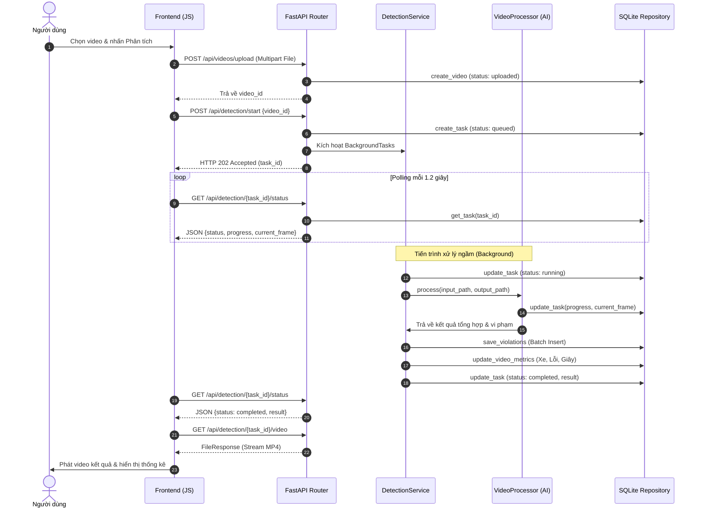

# Kiến trúc hệ thống ITS Wrong-Lane Detection

Tài liệu mô tả chi tiết kiến trúc tổng thể, các tầng chức năng, luồng dữ liệu và thiết kế kỹ thuật của hệ thống nhận diện phương tiện đi sai làn đường (**ITS Wrong-Lane Detection**).

---

## 1. Tổng quan kiến trúc hệ thống

Hệ thống được thiết kế theo mô hình **Kiến trúc phân tầng (Layered Architecture)** kết hợp với cơ chế **xử lý bất đồng bộ (Asynchronous Background Worker)**, đảm bảo khả năng đáp ứng giao diện mượt mà trong khi vẫn thực thi các thuật toán thị giác máy tính nặng nề.

```text
┌────────────────────────────────────────────────────────────────────────┐
│                   TẦNG GIAO DIỆN (PRESENTATION LAYER)                  │
│       Vanilla HTML5 / CSS3 / JavaScript (SPA-like Dashboard)           │
│   [Dashboard]       [New Analysis]       [History]       [Statistics]  │
└───────────────────────────────────┬────────────────────────────────────┘
                                    │ HTTP REST API (JSON / Multipart / Stream)
                                    ▼
┌────────────────────────────────────────────────────────────────────────┐
│                   TẦNG ĐIỀU KHIỂN (API ROUTING LAYER)                  │
│                        FastAPI Application Factory                     │
│   /api/health   /api/videos   /api/detection   /api/violations  /stats │
└───────────────────────────────────┬────────────────────────────────────┘
                                    │ Dependency Injection (Settings, Repository)
                                    ▼
┌────────────────────────────────────────────────────────────────────────┐
│                   TẦNG DỊCH VỤ NGHIỆP VỤ (SERVICE LAYER)               │
│   VideoService          DetectionService            StatisticsService  │
│   (Upload/Validation)   (Task Orchestration)        (Aggregations)     │
└──────────┬────────────────────────┬────────────────────────────────────┘
           │                        │ BackgroundTasks Worker
           ▼                        ▼
┌──────────────────────┐  ┌──────────────────────────────────────────────┐
│  TẦNG DỮ LIỆU CỐT LÕI │  │     TẦNG THỊ GIÁC MÁY TÍNH (CORE AI ENGINE)  │
│  (PERSISTENCE LAYER) │  │                 VideoProcessor               │
│                      │  │  ┌────────────────────────────────────────┐  │
│  SQLite Repository   │  │  │ YOLODetector (Ultralytics YOLOv8)      │  │
│  (WAL Mode, FK=ON)   │  │  └───────────────────┬────────────────────┘  │
│                      │  │                      ▼                       │
│  Bảng:               │  │  ┌────────────────────────────────────────┐  │
│  - videos            │  │  │ VehicleTracker (ByteTrack Association) │  │
│  - detection_tasks   │  │  └───────────────────┬────────────────────┘  │
│  - violations        │  │                      ▼                       │
│                      │  │  ┌────────────────────────────────────────┐  │
│  Thư mục Storage:    │  │  │ LaneDetector (Point-in-Polygon Lookup) │  │
│  - storage/uploads/  │  │  └───────────────────┬────────────────────┘  │
│  - storage/processed/│  │                      ▼                       │
│  - storage/evidence/ │  │  ┌────────────────────────────────────────┐  │
│                      │  │  │ WrongLaneDetector (Rule & History Check│  │
│                      │  │  └───────────────────┬────────────────────┘  │
│                      │  │                      ▼                       │
│                      │  │  ┌────────────────────────────────────────┐  │
│                      │  │  │ AlertManager (Watermark & Deduplicate) │  │
│                      │  │  └────────────────────────────────────────┘  │
└──────────────────────┘  └──────────────────────────────────────────────┘
```

---

## 2. Chi tiết các tầng chức năng

### 2.1. Tầng Giao diện người dùng (Presentation Layer)
- **Công nghệ:** HTML5, CSS3 hiện đại, Vanilla JavaScript (ES6+).
- **Đặc điểm:** Không phụ thuộc framework cồng kềnh (React/Vue/Angular), tải trang tức thì, không cần bước biên dịch (build step).
- **Module trung tâm:** `assets/js/api.js` đóng gói đối tượng `window.ITSApi` bọc các lệnh gọi `fetch()` bất đồng bộ.
- **Trang chức năng:**
  - `dashboard.html`: Tổng quan chỉ số hệ thống và danh sách video gần đây.
  - `detection.html`: Tải video, xem trước (preview), theo dõi tiến trình nhận diện qua Polling 1.2s và phát video kết quả.
  - `history.html`: Tra cứu lịch sử video và hồ sơ các phương tiện vi phạm kèm bộ lọc loại xe và tìm kiếm.
  - `statistics.html`: Phân tích thống kê dạng biểu đồ trực quan.

### 2.2. Tầng Điều khiển API (API Routing Layer)
- **Công nghệ:** FastAPI, Pydantic v2, Uvicorn ASGI Server.
- **Tính năng:**
  - Định tuyến tự động theo nhóm tài nguyên (`prefix="/api"`).
  - Tự động sinh tài liệu chuẩn tương tác Swagger UI (`/docs`) và Redoc (`/redoc`).
  - Cấu hình `CORSMiddleware` cho phép gọi API đa nguồn linh hoạt.
  - Áp dụng kỹ thuật **Dependency Injection** (`Depends(get_settings)`, `Depends(get_repository)`) giúp giảm phụ thuộc và dễ dàng kiểm thử tự động.

### 2.3. Tầng Dịch vụ Nghiệp vụ (Service Layer)
Đóng vai trò điều phối logic ứng dụng, đứng giữa API và tầng xử lý AI / Cơ sở dữ liệu:
- `VideoService`: Kiểm tra định dạng video (`.mp4`, `.avi`, `.mov`, `.mkv`), dung lượng tối đa (`max_upload_bytes`), đọc stream theo từng chunk 1MB chống tràn RAM, sinh mã UUID an toàn và lưu vào thư mục `storage/uploads/`.
- `DetectionService`: Khởi tạo tác vụ nhận diện, cấu hình danh sách chuyển làn cấm (`forbidden_transitions`), khởi chạy luồng nền `BackgroundTasks`, theo dõi và cập nhật tiến trình (progress) liên tục vào database.
- `StatisticsService`: Đọc dữ liệu tổng hợp từ Repository, tính toán tỷ lệ vi phạm (`detection_rate`) và cơ cấu phân bố phương tiện.

### 2.4. Tầng Thị giác Máy tính & AI Lõi (Core AI Pipeline)
Quy trình xử lý khung hình (Frame-by-frame) được điều phối bởi `VideoProcessor`:
1. **`YOLODetector` (Khang):** Tải mô hình YOLOv8n theo cơ chế Lazy Loading (chỉ nạp vào bộ nhớ khi có yêu cầu xử lý), lọc 4 nhóm phương tiện giao thông chuẩn COCO: ô tô (2), xe máy (3), xe buýt (5), xe tải (7).
2. **`VehicleTracker` (Khang):** Tích hợp thuật toán ByteTrack duy trì định danh phương tiện (`track_id`) ổn định qua từng khung hình, lưu vết lịch sử vị trí và vector hướng di chuyển.
3. **`LaneDetector` (Mai):** Đọc file cấu hình đa giác làn đường (`ITS_LANE_CONFIG`), sử dụng giải thuật Point-in-Polygon (Ray casting) kiểm tra điểm tiếp xúc mặt đường (bottom-center) của phương tiện để xác định xe đang nằm trong làn nào.
4. **`WrongLaneDetector` (Khang):** Đánh giá hành vi chuyển làn. Chỉ kích hoạt vi phạm khi xe chuyển sang làn cấm và duy trì trạng thái đó liên tục qua ngưỡng xác nhận `confirm_frames` (mặc định 8 frames) để tránh báo động giả do xe chỉ đè vạch tức thời.
5. **`AlertManager` (Cường):** Quản lý cảnh báo và lưu ảnh bằng chứng JPEG. Khử trùng lặp cảnh báo qua bộ khóa `(track_id, source_lane, destination_lane)` và đóng dấu banner cảnh báo màu đỏ lên ảnh bằng chứng.

### 2.5. Tầng Dữ liệu và Lưu trữ (Persistence Layer)
- **Cơ sở dữ liệu:** SQLite 3 với chế độ ghi nhật ký **WAL (Write-Ahead Logging)**:
  - Cho phép các tiến trình đọc (Frontend xem dashboard/history) và tiến trình ghi (Backend cập nhật tiến độ video) hoạt động đồng thời mà không gây khóa dữ liệu (Database Locked).
  - Bật ràng buộc toàn vẹn khóa ngoại `PRAGMA foreign_keys = ON` và `ON DELETE CASCADE`.
- **Hệ thống tệp (File System):**
  - `storage/uploads/`: Lưu video gốc người dùng tải lên.
  - `storage/processed/`: Lưu video đầu ra đã vẽ bounding box, làn đường và cảnh báo vi phạm.
  - `storage/evidence/`: Lưu trữ ảnh JPEG trích xuất bằng chứng vi phạm phục vụ tra cứu pháp lý.

---

## 3. Luồng dữ liệu hoàn chỉnh (End-to-End Data Flow)



---

## 4. Nguyên tắc thiết kế và ranh giới hệ thống

1. **Minh bạch và thực tế (Honest Reporting):** Hệ thống không tự tạo dữ liệu giả lập. Nếu thiếu file weights YOLO hoặc chưa cấu hình file làn đường, hệ thống sẽ báo rõ trạng thái `detection_only` hoặc thông báo lỗi cụ thể thay vì sinh kết quả ảo.
2. **Khả năng mở rộng (Extensibility):** Cấu trúc phân tầng cho phép dễ dàng thay thế mô hình nhận diện (YOLOv8 sang YOLOv11) hoặc đổi sang cơ sở dữ liệu mạnh mẽ hơn (PostgreSQL) chỉ bằng cách cập nhật tầng Repository mà không phải viết lại logic Frontend.
3. **An toàn bộ nhớ (Resource Efficiency):** Đọc video và tải file theo dạng luồng (chunking stream), dọn dẹp bộ nhớ theo dõi (track pruning) và giải phóng tài nguyên sau khi xử lý xong video.
